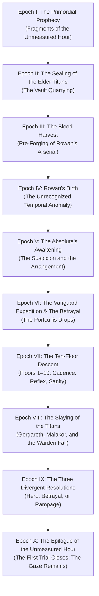
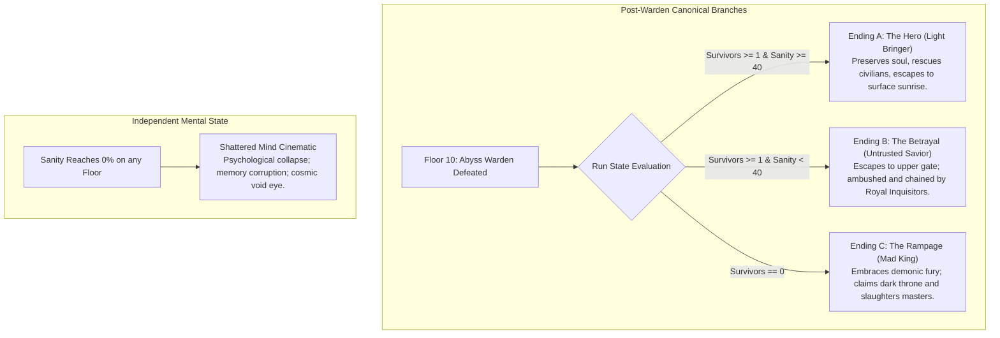

# DUNGEON BREAK: ABYSS ASCENSION — CANONICAL LORE BIBLE
*Authoritative Narrative Canon, Epistemological Framework, Weapon-Blood Origins, The Three Endings, and The Prophecy of the Unmeasured Hour*
**Version:** 8.2.0 (Phase 8B Canon Expansion)  
**Status:** **AUTHORITATIVE & CANONICAL**  
**Classification:** Official Source of Truth for all Dialogue, Cinematics, Codex Entries, and Future Expansions

---

## 1. CANONICAL STORY PREMISE

### 1.1 Rowan and the Sealing
- **Rowan's Identity:** Rowan is an elite knight-vanguard of the Royal Vanguard Cohort. Clad in weathered steel plate, a heavy crimson mantle, and an iron helm with an azure slit, he represents martial discipline, unyielding will, and tactical resolve.
- **The Abandonment:** Rowan did not enter the labyrinth voluntarily. During an expedition into the subterranean rift beneath the kingdom's frontier, his comrades panicked and betrayed him. Dropping the colossal granite entrance slab with runic iron portcullises, the deserters fled into the surface night, leaving Rowan sealed within the lightless abyss.
- **The Only Ascent is Descent:** The entrance portal and upper stairs are irrevocably sealed by colossal granite and ancient runic warding. Rowan's only path to freedom—and the truth behind his betrayal—demands descending through all ten floors of the labyrinth and confronting the Abyss Warden at the bottom of the world.

### 1.2 The Dungeon's True Nature
- **An Ancient Vault Turned Crucible:** The dungeon was originally quarried eons ago not as a prison, but as an ancient cosmic vault to seal away primeval titan abominations sleeping beneath the crust of the realm.
- **The Deliberate Trials:** An unknown cosmic intelligence or architect repurposed the ten floors into a deliberate sequence of escalating trials designed to test the absolute limits of mortal flesh, mind, and spirit.
- **The Crucible of Apotheosis:** The dungeon, the horrors within it, and the weapons placed across its flagstones were engineered for a singular purpose: **to break Rowan down, test his constitution against impossible horrors, and observe what emerges from the crucible**.

---

## 2. EPISTEMOLOGICAL FRAMEWORK: LEVELS OF NARRATIVE TRUTH

To maintain narrative coherence across gameplay, lore entries, and future story expansions, all writers and designers must strictly distinguish between three distinct tiers of knowledge:

```
+--------------------------------------------------------------------------------------------------+
|                                    EPISTEMOLOGICAL TIERS                                         |
+--------------------------------------------------------------------------------------------------+
|  TIER 1: AUTHOR-LEVEL TRUTH       |  • Rowan was born with latent temporal potential.            |
|  (Meta-truth; absolute reality)   |  • The 10-floor dungeon was merely the FIRST trial.          |
|                                   |  • The Absolute investigates the prophecy, acting on suspicion|
+-----------------------------------+--------------------------------------------------------------+
|  TIER 2: CHARACTER KNOWLEDGE      |  • No character recognizes Rowan's temporal potential.       |
|  (In-universe mortal belief)      |  • Rowan believes he is simply fighting to escape.           |
|                                   |  • The King and Inquisitors believe Rowan is a demon vessel. |
|                                   |  • Bosses act as bound trial catalysts executing oaths.     |
+-----------------------------------+--------------------------------------------------------------+
|  TIER 3: PLAYER-DISCOVERED TRUTH  |  • Floors 1–9: Progressive realization of arranged trials.   |
|  (Revealed through gameplay)      |  • Floor 10 Defeat: Revelation of pre-forged weapon blood.   |
|                                   |  • Epilogue: The Absolute's gaze confirms trial one is done. |
+--------------------------------------------------------------------------------------------------+
```

### 2.1 Tier 1: Author-Level Truth (Absolute Reality)
- Rowan possesses latent time-controlling potential inherited or woven into his birth.
- The ancient prophecy foretells that the reign and fate of the Absolute will be brought to an end by the one who commands time ("The Unmeasured Hour").
- The Absolute suspects that Rowan might be the prophesied figure, but does not possess omniscient certainty. The entire ten-floor dungeon was orchestrated as an empirical investigation to test if this mortal vessel exhibits the resonance of time.
- The ten-floor descent, culminating in the defeat of the Abyss Warden, was only the **first trial**. It was never the complete test.

### 2.2 Tier 2: What Characters Know (In-Universe Perception)
- **Rowan:** Has no conscious comprehension of his temporal potential. He experiences combat as adrenaline, reflex, and desperate survival. He does not know how or why the dungeon tempo seems to bend to his will.
- **The Deserters:** Fled out of raw animal terror and an inexplicable dread radiating from Rowan himself.
- **The King & Royal Court:** Subservient to the Absolute's psychic whisperings. They regard Rowan not as a prophesied liberator, but as a dangerous, half-transformed abomination that must be purged or contained.
- **The Dungeon Bosses (Gorgaroth, Malakor, Warden):** Ancient bound titans performing their binding covenant. They recognize Rowan as a challenger of prophesied stature, but do not know whether he will triumph or perish.

### 2.3 Tier 3: What the Player Learns at the Ending
- During the run, the player uncovers that the dungeon is an arranged crucible and that weapons were pre-forged from boss blood.
- Upon defeating the Warden and choosing an ending, the player witnesses Rowan's mortal fate (Heroic salvation, Royal betrayal, or Demonic rampage).
- In the new post-ending revelation, the player discovers that the entire ten-floor ordeal was merely the opening gambit of the Absolute's investigation—and that the true trial of the Unmeasured Hour lies beyond.

---

## 3. THE AUTHORITATIVE CHRONOLOGY: THE TEN EPOCHS



1. **Epoch I: The Primordial Prophecy:** Eons before the founding of the surface kingdom, ancient seers carve fragmented glyphs into the bedrock of the world. The prophecy warns of the *Unmeasured Hour*—an epoch where an entity born outside linear temporal causality will rise to challenge and unseat the Absolute.
2. **Epoch II: The Sealing of the Elder Titans:** The world-strata are quarried to inter primeval behemoths: Gorgaroth, titan of terrestrial iron; Malakor, entity of spatial void; and the Abyss Warden, supreme keeper of the Sunken Citadel.
3. **Epoch III: The Blood Harvest & Pre-Forged Arsenal:** Long before Rowan's birth, an unknown architect harvests the blood of these chained titans. Gorgaroth's blood tempers the Broadsword and Spear; Malakor's spatial essence infuses the Dagger and Bow; the Warden's dark essence is locked within the War Axe. The weapons are cached along the strata to await the candidate.
4. **Epoch IV: Rowan's Birth:** Rowan is born to mortal bloodlines. Woven into his soul is a dormant temporal resonance. He exhibits no outward sorcery; he bleeds, hungers, and grows like any mortal, eventually enlisting in the King's Vanguard.
5. **Epoch V: The Absolute's Suspicion:** The celestial red eye perceives a minute tremor in the cosmic temporal fabric surrounding the vanguard knight. Unsure whether Rowan is the prophesied time-bearer or an insignificant mortal spark, the Absolute begins orchestrating events to force Rowan into the crucible.
6. **Epoch VI: The Vanguard Expedition & Abandonment:** Whispers of an ancient evil draw the Vanguard to the subterranean gate. As the ground rumbles, the cohort panics, drops the great stone slab, and abandons Rowan in the dark.
7. **Epoch VII: The Ten-Floor Descent:** Rowan traverses the ten distinct biomes of the labyrinth. The stone shifts, measuring his cadence, endurance, sanity, and poise.
8. **Epoch VIII: The Three Titan Trials:** Rowan faces Gorgaroth (Strength), Malakor (Spatial Identity), and the Abyss Warden (Apotheosis Threshold). Each titan falls, confirming his physical, mental, and spiritual resilience.
9. **Epoch IX: The Three Canonical Resolutions:** Rowan reaches the heart of the Sunken Citadel. Depending on his sanity and compassion for fallen survivors, he enacts one of three established fates:
   - *Hero:* Rejects dark apotheosis and leads survivors to surface dawn.
   - *Betrayal:* Escapes upward only to be ambushed and chained by the King's guard.
   - *Rampage:* Yields to demonic fury, claiming the dark throne and slaughtering the architects.
10. **Epoch X: The Revelation of the Unmeasured Hour:** Regardless of Rowan's immediate mortal fate, the celestial red eye remains unblinking in the cosmos. The ten-floor dungeon was merely the *first trial*. The test of whether Rowan can awaken the Unmeasured Hour has only just begun.

---

## 4. TEN-FLOOR STRUCTURAL & ENVIRONMENTAL WORLD-BUILDING

The canonical ten-floor structure uses established naming, biome aesthetics, and chronicle discoveries:

| Floor | Canonical Name | Biome Key | Boss Encounter | Environmental Theme & Chronicle Core |
| :---: | :--- | :--- | :--- | :--- |
| **1** | **Stone Keep** | `stone_keep` | *None* | **The Forgotten Seal:** Slabs of weathered granite; the drop of the entry portcullis; cold ash and abandoned vanguard torches. |
| **2** | **Forgotten Crypt** | `forgotten_crypt` | *None* | **The Deserters' Silence:** Ancient sepulchers littered with discarded cohort bucklers; stone that closes behind travelers. |
| **3** | **Iron Fissure** | `iron_fissure` | **Gorgaroth the Iron Jailer** | **The Trial of Iron:** Chained masonry pillars, blood-stained iron flagstones; trial of raw brute strength and endurance. |
| **4** | **Sunken Crypt** | `sunken_crypt` | *None* | **The Deeper Measure:** Non-Euclidean shifting corridors, dynamic trap recalibration; stone that records every footstep and parry. |
| **5** | **Infernal Catacombs** | `infernal_catacombs` | *None* | **The Weight of the Dark:** Suffocating heat, red embers, sanity erosion; shadows that mimic fallen comrades and trauma echoes. |
| **6** | **Void Rift** | `void_rift` | **Malakor the Void Reaver** | **The Void's Question:** Shattered reality geometry, purple void tears, hovering dimensional platforms; trial of mental identity. |
| **7** | **Molten Core** | `molten_core` | *None* | **Echoes of Purpose:** Obsidian glass and magma canals; alarming realization that chests, shrines, and weapons are placed deliberately. |
| **8** | **Shadow Depths** | `shadow_depths` | *None* | **Before the Blade:** Pitch-black halls with whispering walls; realization that weapon runes match the ancient architecture. |
| **9** | **Threshold of Oblivion** | `threshold_oblivion` | *None* | **The Last Measure:** Violet runic stelae bordering the final gate; the threshold where survival yields to apotheosis. |
| **10** | **Throne of the Abyss Warden** | `warden_throne` | **The Abyss Warden** | **The Warden's Last Trial:** Colossal Sunken Citadel throne chamber; the revelation of pre-forged blood weapons and the crucible. |

---

## 5. PRE-FORGED WEAPON-BLOOD ORIGINS

> [!IMPORTANT]
> **BEDROCK RULE OF DUNGEON BREAK WEAPON DESIGN:**
> Rowan does **NOT** forge weapons from bosses after killing them. The weapons were crafted **eons before Rowan arrived**, using the harvested blood and essence of chained ancient titans. Rowan discovers them placed deliberately along his path.

```
+-------------------------------------------------------------------------------------------------------+
|                                    CRUCIBLE OF BLOOD & STEEL                                          |
+-------------------------------------------------------------------------------------------------------+
|  TITAN CATALYST       |  HARVESTED ESSENCE      |  PRE-FORGED ARSENAL & COMBAT PROPERTIES             |
+-----------------------+-------------------------+-----------------------------------------------------+
|  Gorgaroth            |  Dense Ferrous Blood    |  • Steel Broadsword: Clean 68° arc, high poise hit  |
|  (The Iron Jailer)    |  (Terrestrial Density)  |  • Radiant Trident/Spear: Linear corridor pierce    |
+-----------------------+-------------------------+-----------------------------------------------------+
|  Malakor              |  Spatial Void-Essence   |  • Shadow Dagger: Micro-phase teleport & crit slash |
|  (The Void Reaver)    |  (Dimensional Warp)     |  • Arcane Hunter's Bow: Void-velocity piercing shot |
+-----------------------+-------------------------+-----------------------------------------------------+
|  The Abyss Warden     |  Volcanic Abyssal Blood |  • Heavy War Axe: Cleave detonation & shockwave     |
|  (Sunken Monarch)     |  (Apotheosis Catalyst)  |  • Sovereign Relics: Unlocked during final descent  |
+-------------------------------------------------------------------------------------------------------+
```

### 5.1 Floor 3: Gorgaroth, the Iron Jailer
- **The Trial of Iron:** Gorgaroth is a towering brute clad in shattered dungeon shackles, swinging an iron masonry pillar. His trial tests whether a challenger possesses the brute physical strength, reflex, and endurance to penetrate the deeper strata.
- **Weapon Blood Origin:** Gorgaroth's dense, ferrous blood was harvested eons ago to temper the **Sword** (clean, high-density cutting arcs) and the **Trident/Spear** (linear corridor penetration).

### 5.2 Floor 6: Malakor, the Void Reaver
- **The Trial of the Void:** Malakor is an ethereal sorcerer who bends spatial geometry, teleports through dark rifts, and summons tracking soul projectiles. His trial tests whether a challenger can maintain their identity and mental sanity under impossible dimensional pressure.
- **Weapon Blood Origin:** Malakor's spatial void-essence was distilled into the **Dagger** (giving it its micro-lunge and phantom phase-shift capacity) and the **Arcane Bow** (infusing arrows with void velocity that ignore terrestrial drag).

### 5.3 Floor 10: The Abyss Warden
- **The Final Gate:** The Warden is the supreme keeper of the Sunken Citadel. He conducts the final trial—a brutal test of lethal precision, spatial awareness, and endurance against abyssal shockwaves and soaring telekinetic greatswords.
- **Weapon Blood Origin:** The Warden's volcanic, abyssal blood was bound into the **Heavy War Axe**, providing its devastating explosive shockwaves and execution power.

---

## 6. THE ABSOLUTE & THE PROPHECY OF THE UNMEASURED HOUR

### 6.1 Nature and Representation of the Absolute
- **Visual Identity:** The Absolute is represented by the approved **small red pixel-art eye**. It blinks, watches, and radiates quiet cosmic menace. This visual identity is preserved across all cinematics, HUD elements, and archives.
- **Cosmic Stature:** The Absolute is neither a conventional god nor a dungeon monster. It is an ancient celestial consciousness observing reality from outside terrestrial time.
- **Modus Operandi:** The Absolute does not command legions directly; it whispers into the minds of monarchs, bends spatial architecture, and orchestrates situations where mortals must test their absolute limits.

### 6.2 The Prophecy of the Unmeasured Hour
- **Ancient Text:** Fragmented inscriptions recovered from prehistoric vaults speak of an entity who will bring about the dusk of the Absolute:
  > *"When the hour is unmeasured and the pendulum halts between breaths, the eye that watches eternity shall blink for the final time. Born of mortal bone but carrying the stillness of time, the Vanguard shall walk upon the shards of the shattered clock."*
- **The Absolute's Dilemma:** The Absolute cannot perceive its own death directly, but it senses the ripples of temporal disturbance. It has watched empires rise and turn to dust without ever encountering a mortal who could alter the flow of time.
- **Rowan as the Suspect:** When Rowan's life-thread flickers with subtle temporal anomalies, the Absolute directs its attention to him. The dungeon is prepared not to execute him, but to subject him to extreme mortal pressure—because temporal gifts awaken only when existence itself is pushed to the edge of extinction.

---

## 7. ROWAN'S LATENT TEMPORAL POTENTIAL

### 7.1 Author-Level Truth vs. Gameplay Representation
- **Latent, Not Conscious:** Rowan does not possess spells called "Stop Time" or "Rewind." He is not a mage. His temporal resonance manifests internally as unnatural combat perception, impossible reaction speeds, and micro-temporal cadence regulation.
- **The Speed Regulator Connection:** In Phase 8A, live speed regulation (`0.50×`, `1.00×`, `1.50×`, `2.00×`) was added to gameplay. While official speedrun timers remain strictly tied to unscaled wall-clock seconds (speedrunning integrity), Rowan's perceived combat flow stretches and compresses. This gameplay feature mirrors his dormant potential: **Rowan can instinctively bend combat cadence, yet cosmic time marches forward uncorrupted.**
- **The Unawakened State:** Throughout the events of *Dungeon Break: Abyss Ascension*, Rowan never achieves full, conscious mastery of time. He survives as a mortal warrior fighting with blood, steel, and willpower.

---

## 8. THE THREE CANONICAL ENDINGS & SHATTERED MIND

The game contains three distinct canonical resolutions following the defeat of the Abyss Warden, plus one independent psychological collapse condition:



### 8.1 Ending A: The Hero (Light Bringer)
- **Requirement:** Saved ≥ 1 Survivor AND Sanity ≥ 40.
- **Theme:** Unyielding humanity, preservation of the soul, and redemption.
- **Resolution:** Rowan rejects the dark apotheosis offered by the Sunken Citadel. Refusing to become a demonic weapon for an unknown master, he leads the surface survivors he protected through the crumbled upper vault ceiling into the warm light of sunrise.

### 8.2 Ending B: The Betrayal (Untrusted Savior)
- **Requirement:** Saved ≥ 1 Survivor AND Sanity < 40.
- **Theme:** Institutional conspiracy, cosmic manipulation, and tragedy.
- **Resolution:** Rowan ascends to the upper gates carrying rescued survivors, believing he has triumphed. But the Royal Inquisitors and King's Guard wait with crossbows and chains. The King has secretly obeyed the Absolute's mental whisperings; Rowan was sacrificed into the crucible by royal decree. Deemed a dangerous, half-transformed anomaly, Rowan is struck down and cast back into the pit.

### 8.3 Ending C: The Rampage (Mad King / Dark Sovereign)
- **Requirement:** Saved == 0 Survivors (regardless of sanity).
- **Theme:** Destructive wrath, defiance through vengeance, and demonic ascension.
- **Resolution:** Rowan allows his fracturing mind and fury to fully ignite. Absorbing the Warden's dark essence, he undergoes violent supernatural awakening, shattering the throne room and ascending through the fortress in a whirlwind of fire and vengeance. He does not seek peace—he seeks the throat of the architect.

### 8.4 Shattered Mind: Independent Sanity Collapse
- **Requirement:** Rowan's Sanity reaches 0% during active dungeon gameplay.
- **Theme:** Psychological disintegration, world erasure, and cosmic horror.
- **Distinction:** **Shattered Mind is NOT an ending to the Warden fight.** It is an independent psychological failure condition. The physical dungeon dissolves, the approved red pixel-art eye manifests across the cosmos, and Rowan experiences the surreal erasure of his past memories (the campfire, the companions, the burning battlefield). It retains its approved standalone cinematic and does NOT transition into the post-Warden epilogue.

---

## 9. THE NEW FINAL REVELATION: THE FIRST TRIAL

### 9.1 The Epilogue Concept: The Crucible Unfinished
Regardless of which of the three canonical paths Rowan takes following the Warden's defeat—whether he walks into the sunlight, falls in chains before the King, or ascends as a demon of vengeance—the underlying cosmic reality remains the same:

> **The ten-floor dungeon was only the first trial. It was never the complete test.**

### 9.2 The Absolute's Conclusion
After Rowan triumphs over the Abyss Warden:
1. **The Physical Test is Passed:** Rowan has proven that mortal flesh can survive Gorgaroth's iron, Malakor's void rifts, and the Warden's dark storm.
2. **The Temporal Question Remains Unanswered:** Rowan did *not* consciously stop time, reverse casualty, or unmake the clock. He survived through sheer martial defiance.
3. **The Investigation Continues:** The Absolute does not destroy Rowan, nor does it crown him. It records the data of his descent. Rowan may indeed be the vessel of the Unmeasured Hour, but his power remains locked behind deeper dimensional thresholds. The real crucible is yet to come.

---

## 10. AUTHORITATIVE IN-ENGINE IMPLEMENTATION: POST-ENDING EPILOGUE (PHASE 8C)

> [!NOTE]
> **PHASE 8C STATUS:** Fully implemented in [`js/cinematics/EpilogueCinematic.js`](file:///Users/ramteja/Downloads/Dungeon%20Break%20v2.0/js/cinematics/EpilogueCinematic.js) and verified across all ending routes. Zero 3D models or raster atlases used; 100% Canvas 2D procedural rendering with approved small red pixel-art eye and synthesized audio layers.

### 10.1 Placement & Sequence Flow
- The epilogue executes immediately upon the completion of any of the three canonical Warden endings (`HeroCinematic`, `BetrayalCinematic`, or `RampageCinematic`).
- It allows the earned ending to reach its full narrative and emotional resolution, holds on a breathing black silence, and then reveals the true cosmic vault beneath the world.
- Upon completion (or skip after the 3.0s hold), it transitions gracefully into `Credits.start(branch)` with the authentic background variant, soundtrack, and menu navigation.
- It is strictly insulated from `ShatteredMindCinematic`, normal deaths, and standalone menu credits.
- Duplicate triggers per run are prevented via `_epilogueDispatchedRunId`.

### 10.2 Narrative Beat Sheet (Duration: ~22.5 Seconds)

```
[BEAT A: 0.00 – 3.20s] — THE PURE VOID & SILENCE
Screen transitions from the previous ending's final black hold.
Complete dead silence for the initial hold.
At 1.60s, a low, subsonic 42Hz drone fades in gradually via SoundManager ('sanity_drone').

[BEAT B: 3.20 – 8.50s] — THE ANCIENT CYCLOPEAN VAULT
The cyclopean vault fades in with cold violet-black radial ambiance.
Monolithic fluted granite pillars flank the view, surmounted by a curved astronomical bronze arch with 12 hour notches.
Jagged floor chasms emit deep violet abyss luminescence.
Floating dust motes and drifting temporal sparks ascend through the depth.

[BEAT C: 8.50 – 13.80s] — THE SURVIVING RECORD
A colossal central basalt stele rises from the dark floor.
Progressive chiseled Cinzel gold inscription appears:
"Steel has endured the iron. Flesh has survived the void." (8.60s)
"Yet the pendulum has not ceased its swing." (10.80s)
"The ten floors were but the threshold." (12.60s)

[BEAT D: 13.80 – 17.20s] — THE ABSOLUTE'S OBSERVATION
Suspended at the upper apex beneath the astronomical arch, the approved small red pixel-art eye awakens.
Unblinks smoothly with cold, unhurried cadence as red aura and starlight particles radiate.
SFX: 'eye_awaken' and 'eye_blink'.

[BEAT E: 17.20 – 21.20s] — THE UNMEASURED HOUR & CORE PROCLAMATION
A resonant thirteenth chime tone strikes (392Hz triangle + 196Hz sub-octave with long natural decay).
The red eye narrows into an analytical, calculating slit (blinkProg = 0.52).
Monumental proclamation emblazoned across the stele:
“THE DESCENT WAS ONLY THE FIRST TRIAL.”
(Sub-proclamation below):
“THE UNMEASURED HOUR AWAITS.”

[BEAT F: 21.20 – 22.60s] — CLEAN DISSOLVE TO CREDITS
The eye closes completely into a horizontal slit.
The chamber dissolves into a rich radial violet-black vignette.
Seamless handoff to Credits.start(branch) with living end-credit background and soundtrack.
```

---

## 11. CONTINUITY CONFLICT AUDIT & DOCUMENTED DISCREPANCIES

During the Phase 8B source-of-truth inspection, several genuine narrative and mechanical discrepancies were identified in the existing codebase. In accordance with operational guidelines, these conflicts are formally documented here rather than silently altered:

| Subsystem / File | Established Lore Bible Rule | Existing Code Implementation | Canonical Reconciliation & Resolution Plan |
| :--- | :--- | :--- | :--- |
| **Floor Warp Quotes**<br>[`js/data/floors.js:25-36`](file:///Users/ramteja/Downloads/Dungeon%20Break%20v2.0/js/data/floors.js) | "Lyra" is categorized as a legacy hallucination or civilian memory echo, not core canon. | Floor 1 warp quote mentions *"the light of your eyes, Lyra"* and Floor 9 mentions *"Hold on, Lyra... Father is here."* | **Documented Discrepancy:** The warp voice lines represent Rowan's decaying sanity projecting grief onto a hallucinated loved one. Rowan believes he hears his daughter; the abyss weaponizes this illusion to drive him deeper. |
| **Gorgaroth's Title**<br>[`js/data/achievements.js:21`](file:///Users/ramteja/Downloads/Dungeon%20Break%20v2.0/js/data/achievements.js)<br>[`js/ui/BossBar.js`](file:///Users/ramteja/Downloads/Dungeon%20Break%20v2.0/js/ui/BossBar.js) | Canonical title is **Gorgaroth the Iron Jailer** (reflecting trial of iron and chains). | `achievements.js` calls him *"Iron Warden"*; `BossBar.js` and `MainMenu.js` call him *"The Defiler"*. | **Documented Discrepancy:** In-universe epithets vary: the cohort feared him as "The Defiler", the Sanctum records him as "The Iron Warden", but the Archival Lore Bible establishes his true trial function as **"The Iron Jailer"**. |
| **Malakor's Title**<br>[`js/data/achievements.js:22`](file:///Users/ramteja/Downloads/Dungeon%20Break%20v2.0/js/data/achievements.js)<br>[`js/data/bosses.js`](file:///Users/ramteja/Downloads/Dungeon%20Break%20v2.0/js/data/bosses.js) | Canonical title is **Malakor the Void Reaver** (reflecting spatial tears and void blood). | `bosses.js` and `MainMenu.js` call him *"The Dreadlord"*. | **Documented Discrepancy:** "Dreadlord" is his ancient heraldic title from the pre-collapse kingdom; "Void Reaver" is his functional trial designation in the Grand Archive. |
| **Speed Regulation & Timers**<br>[`js/core/GameLoop.js:111-125`](file:///Users/ramteja/Downloads/Dungeon%20Break%20v2.0/js/core/GameLoop.js) | Official speedrun records must track real elapsed wall-clock seconds. | Simulation runs at `GAME_SPEED` (`0.50×` to `2.00×`), but timers increment by unscaled `dt`. | **Harmonious Canonical Feature:** Mechanically resolved in Phase 8A. Narratively reconciled: Rowan's perception bends combat tempo, but the absolute cosmic clock of the universe never bends. |

---

## 12. PROTECTED CANON & DELIBERATELY UNRESOLVED MYSTERIES

To maintain the atmospheric suspense, cosmic dread, and intellectual integrity of *Dungeon Break*, the following canonical pillars are strictly protected and must **NEVER** be reduced to simplistic explanations:

1. **The Ultimate Nature of the Absolute:** Is the Absolute a creator deity, a cosmic parasite feeding on struggle, an artificial celestial construct, or a survivor from a previous universe? This remains deliberately unresolved.
2. **The Origin of the Prophecy:** Who authored the fragments of the Unmeasured Hour? Was it an ancient civilization that fell fighting the Absolute, or a message sent backward from the end of time?
3. **The Fate of Rowan's Soul:** Does Rowan possess true free will, or is his defiance simply another calculated parameter in the Absolute's cosmic ledger?
4. **The Eight Milestones of The Last Witness:** The requirement of witnessing all eight fates (5 deaths and 3 Warden endings) remains strictly intact. The prophecy does not bypass this achievement.
5. **The Sanctum of the Last Ember:** The gift invitation, its cinematic, and the developer-password reveal remain completely separate endgame secrets, insulated from core story progression.
