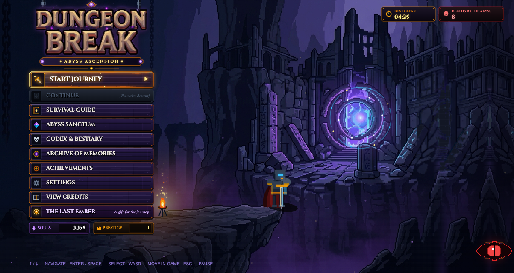
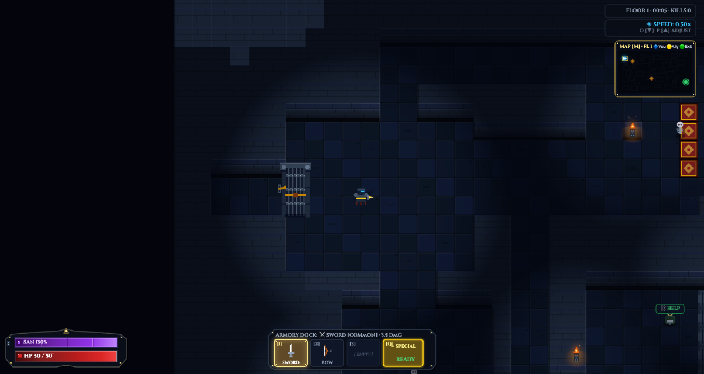
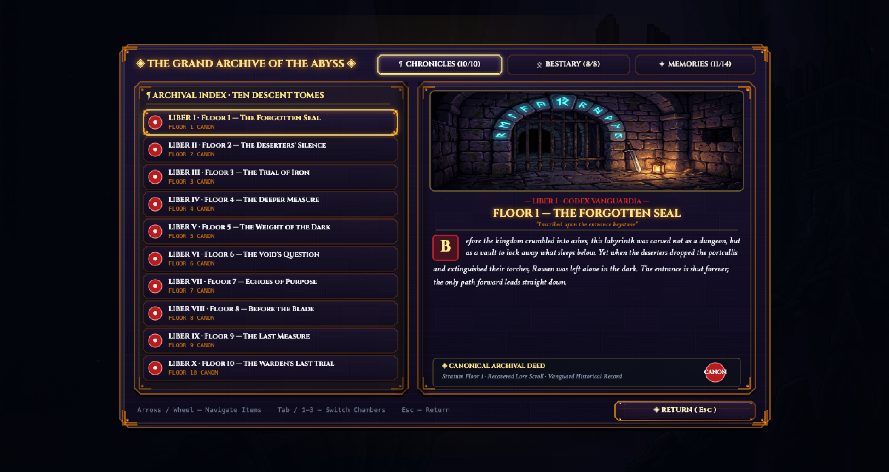
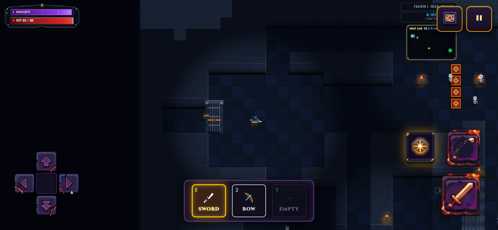
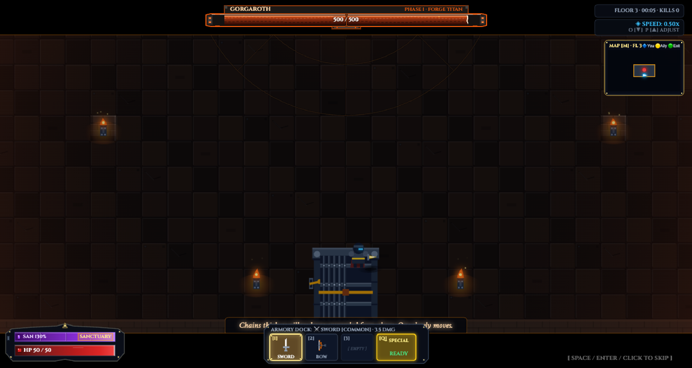
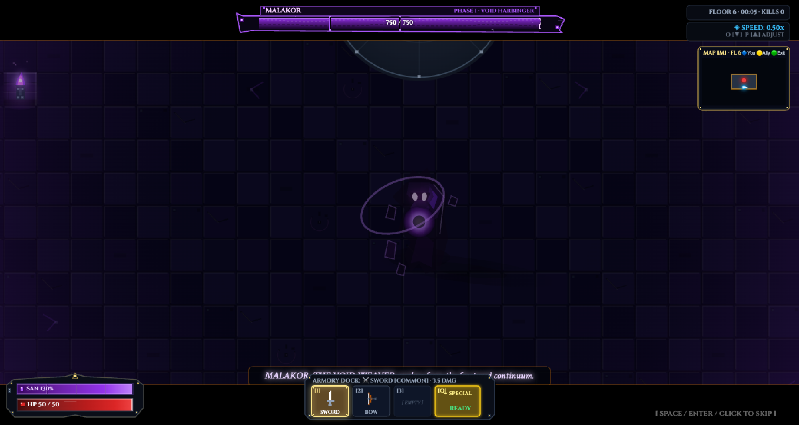
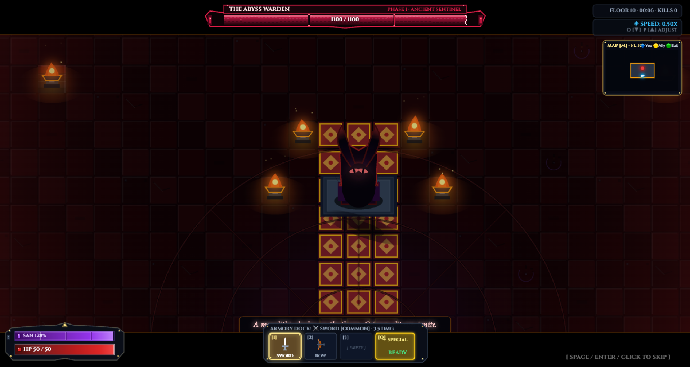
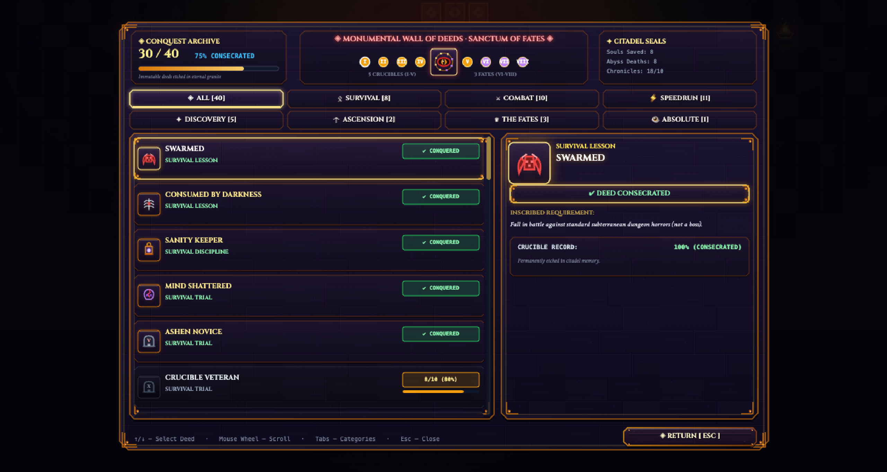
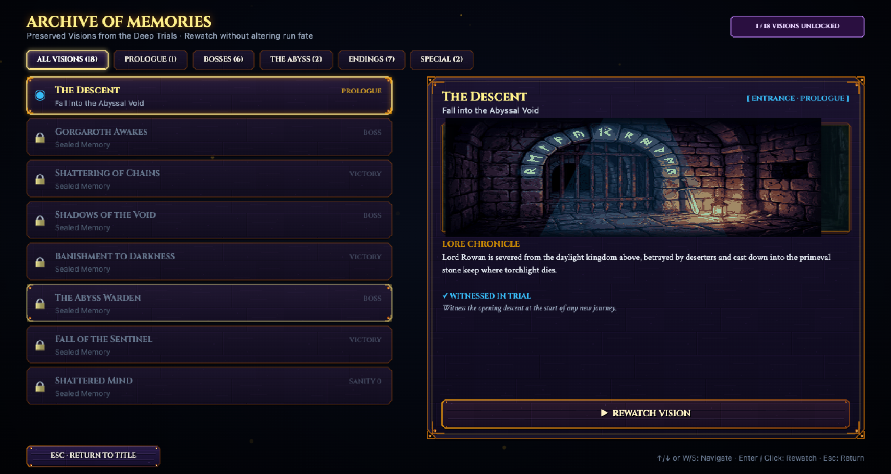
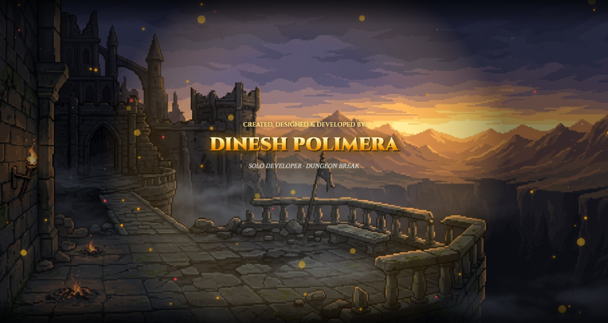

# Dungeon Break — Abyss Ascension Edition

<p align="center">
  
</p>

<p align="center">
  <strong>A dark-fantasy 2D roguelite action dungeon crawler built with pure Canvas 2D and modular ES6 architecture.</strong>
</p>

<p align="center">
  <a href="https://dungeon-break-abyss-ascension.vercel.app/"><strong>▶ PLAY ONLINE (Vercel)</strong></a> •
  <a href="https://pdineshsampathram-spec.github.io/dungeon-break-abyss-ascension/"><strong>▶ PLAY ONLINE (GitHub Pages)</strong></a> •
  <a href="#gameplay-features">Features</a> •
  <a href="#screenshots-gallery">Showcase</a> •
  <a href="#controls--how-to-play">Controls</a> •
  <a href="#running-locally">Local Setup</a> •
  <a href="#technology--architecture">Architecture</a>
</p>

---

## About the Game

Cast into the subterranean depths after a cruel betrayal at the citadel gate, **Lord Rowan** must survive a descent through ten treacherous dungeon floors. What begins as a desperate struggle to reach the surface transforms into an ancient crucible—a deliberate gauntlet testing strength, resolve, and the limits of human sanity.

Face monstrous jailers, unearth sacred boss bloodlines forged into forgotten weaponry, rescue terrified survivors scattered through the dark, and uncover the truth behind the enigmatic gaze of **The Absolute**.

> *"The descent is not an escape. It is an awakening."*

---

## Gameplay Features

### ⚔️ Ten-Floor Descent & Colossal Boss Trials
- **Floor 1–2 (The Upper Dungeons):** Skeleton vanguards, archers, spike traps, and crumbling masonry.
- **Floor 3 (The Iron Keep — Gorgaroth):** Confront Gorgaroth, the Iron Jailer, wielding a massive war pillar amidst magma channels and shattered chains.
- **Floor 4–5 (The Sunken Crypts):** Shadow stalkers, void wraiths, pressure plates, and dark sanctum chambers.
- **Floor 6 (The Void Sanctum — Arch-Lich Malakor):** Face Malakor as he weaves nether rifts and teleports through non-Euclidean space.
- **Floor 7–9 (The Abyssal Foundations):** Deep elite sentinels, temporal echoes, and fractured reality.
- **Floor 10 (The Throne of Ruin — The Abyss Warden):** Confront the immortal four-winged Warden and his dreaded blade at the heart of the world.

### 🗡️ Weapon Arsenal & Forged Rarities
- **5 Authentic Weapon Archetypes:**
  - **Sword:** Balanced slashing sweep with moderate poise damage.
  - **Axe:** Heavy cleaving arc with ground-shattering burst damage.
  - **Dagger:** Rapid thrusts with tactical shadow step teleportation.
  - **Bow:** Long-range precision piercing arrows.
  - **Spear / Trident:** Thrusting reach with multi-target knockback.
- **Rarity Tiers:** Common, Rare, Epic, and Legendary with deterministic stat scaling and visual glow accents.
- **Active Weapon Dock:** Equip and cycle up to 3 weapons in real time with instant numerical hotkeys or mobile tap docks.

<p align="center">
  
</p>

### 🧠 Sanity System & The Shattered Mind
- Rowan's sanity drains under darkness, enemy proximity, and supernatural terror.
- Maintain your mind through light sources, restorative shrines, and combat triumphs.
- Depleting sanity to zero fractures perception, erasing dungeon walls and triggering the psychological **Shattered Mind** outcome.

### 📜 Codex, Bestiary & Illustrated Chronicles
- **Dungeon Chronicles:** Ten illustrated scrolls detailing the lore, architecture, and history of each subterranean floor.
- **Living Bestiary:** Interactive anatomical dossiers, attack patterns, and weakness logs for every monster and boss.
- **Archive of Memories:** Replay unlocked narrative cutscenes, boss confrontations, and distinct ending visions safely with zero progression loss.

<p align="center">
  
</p>

### 🏆 Achievements Wall & Speedrun Chronometer
- **50+ Hand-Crafted Achievements:** Combat masteries, survival feats, flawless boss victories, secret discoveries, and the ultimate 8-milestone **The Last Witness**.
- **Integrated Speedrun Timer:** Precise frame-accurate run chronometer displaying split times, floor milestones, and personal records.

### 📱 Ergonomic Mobile Controls & Live Speed Adjustment
- **Tactile Touch Controls:** Dedicated floating D-pad, primary attack, special consecrated ability, ranged bow shot, and a 3-slot mobile weapon dock.
- **Live Speed Regulator:** Seamlessly shift game execution speed in real time between `0.50×`, `1.00×`, `1.50×`, and `2.00×`.

<p align="center">
  
</p>

---

## Screenshots Gallery

| 01. The Title Sanctuary | 02. Active Descent Gameplay |
|:---:|:---:|
|  |  |
| *Sculpted stone plaque, portal effects, and relic buttons* | *Real-time combat HUD, dynamic lighting, and dungeon masonry* |

| 03. Mobile Responsive Controls | 04. Gorgaroth (Floor 3 Boss) |
|:---:|:---:|
|  |  |
| *Ergonomic D-pad, weapon dock, and combat action cluster* | *The Iron Jailer slams his pillar in the magma chamber* |

| 05. Arch-Lich Malakor (Floor 6 Boss) | 06. The Abyss Warden (Floor 10 Apex) |
|:---:|:---:|
|  |  |
| *Spatial rifts and spectral robes inside the Void Sanctum* | *Four-winged sentinel brandishing the Dreadblade on the Sunken Throne* |

| 07. Codex & Illustrated Chronicles | 08. Achievements Archive |
|:---:|:---:|
|  |  |
| *Deep lore archives, floor chronicles, and enemy bestiaries* | *Milestone tracking, categorized badges, and progression wall* |

| 09. Cinematic Archive of Memories | 10. Living Ending Credits |
|:---:|:---:|
|  |  |
| *Safe presentation rewatch for all major narrative visions* | *Living ending credits suite with branch-specific conclusions* |

---

## Controls & How to Play

### 💻 Desktop Keyboard & Mouse

| Action | Primary Key | Secondary Key |
|:---|:---:|:---:|
| **Move Up / Down / Left / Right** | `W` `A` `S` `D` | `↑` `←` `↓` `→` |
| **Primary Attack** | `Left Mouse Click` | `J` |
| **Special Consecrated Ability** | `Q` | `K` |
| **Dodge / Dash** | `Spacebar` | `Shift` |
| **Switch Weapon (Slots 1, 2, 3)** | `1`, `2`, `3` | `Mouse Wheel` |
| **Toggle Minimap / Full Map** | `M` | `Tab` |
| **Pause Menu / Settings** | `Escape` | `P` |
| **Adjust Game Speed** | `[` / `]` | `Numpad 1–4` |

### 📱 Mobile Touch Ergonomics
- **Directional D-Pad (Left):** Smooth 8-directional player traversal.
- **Combat Cluster (Right):** Primary attack button (`⚔`), Bow shot (`🏹`), and Special skill (`✦`).
- **Weapon Dock (Bottom Center):** Tap any unlocked weapon slot (`1`, `2`, `3`) to swap weapons instantly.
- **In-Game HUD Buttons (Top Corners):** Top-left map button (`🗺️`), top-right pause/speed button (`⏸`).

---

## Running Locally

Because Dungeon Break uses modern **ES6 Modules** and procedural audio assets, running it directly via `file://` will be blocked by browser CORS security policies. A lightweight local HTTP server is required.

### Option 1: Node.js (Recommended)
```bash
# Clone the repository
git clone https://github.com/pdineshsampathram-spec/dungeon-break-abyss-ascension.git
cd dungeon-break-abyss-ascension

# Start the built-in development server
npm start
```
Then navigate to:  
`http://localhost:8080`

### Option 2: Python 3
```bash
python3 -m http.server 8080
```
Then navigate to:  
`http://localhost:8080`

### Option 3: VS Code Live Server
Right-click `index.html` in VS Code and select **Open with Live Server**.

---

## Technology & Architecture

Dungeon Break is engineered with a strict **no-runtime-framework** philosophy:

- **Rendering Engine:** Hand-crafted HTML5 Canvas 2D engine rendering at a fixed virtual coordinate space (`960 × 540` / `896 × 640`), dynamically upscaled to fit any display without distortion.
- **Modular ES6 Architecture:** Clean separation of concerns across core loops, combat math, procedural world generation, audio mixing, UI state machines, and particle rendering.
- **Procedural Character & Boss Art:** Characters, animations, particle effects, and bosses are rendered entirely in code via mathematical Canvas 2D pathing (zero heavy 3D assets or bloated sprite sheets).
- **Audio Engine:** Dual-pipeline Web Audio API procedural sound synthesizer for dynamic hit impacts, sub-bass rumbles, and chimes, paired with an ambient streaming music manager with linear crossfading.
- **Persistence:** LocalStorage serialization with corrupt-data fallback, cross-run milestone tracking, and deterministic run configurations.

---

## Credits

**Created by Dinesh Polimera**

*Special thanks to all playtesters and adventurers who dared to venture into the Abyss.*

---

## Release Status & Notes

- **Version:** v8.0.0 — Abyss Ascension Edition
- **Target Platform:** Modern Web Browsers (Chrome, Edge, Firefox, Safari on Desktop & Mobile)
- **Deployment Status:** Static hosting verified for GitHub Pages.
- **Known Limitations:**
  - Web Audio requires a user gesture (click or tap) to initialize audio context in accordance with browser autoplay policies.
  - Very old mobile browsers without ES6 module support are not supported.

---

<p align="center">
  <sub>Dungeon Break: Abyss Ascension Edition © 2026. All rights reserved.</sub>
</p>
