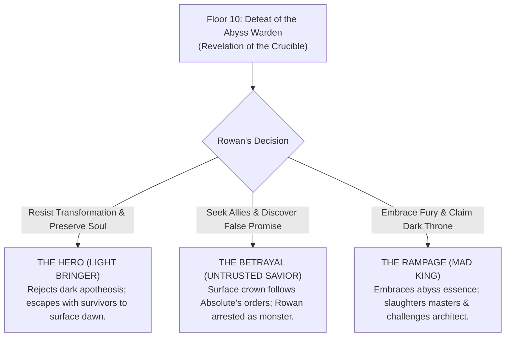

# DUNGEON BREAK — OFFICIAL LORE BIBLE & ARCHIVAL CHRONICLES
*Authoritative Narrative Canon, Trial Structures, Weapon-Blood Origins & Ten-Floor Worldbuilding*

---

## 1. THE FOUNDATIONAL CANON (CONFIRMED TRUTHS)

This section contains the bedrock, unalterable narrative canon of *Dungeon Break — Abyss Ascension*. All dialogue, Codex entries, memory echoes, and future content must adhere strictly to these confirmed facts.

### 1.1 Rowan and the Sealing
- **Rowan's Identity:** Rowan is a resolute knight-vanguard who marched with an expeditionary vanguard. 
- **The Abandonment:** Rowan did not enter the dungeon voluntarily. He was betrayed and abandoned by deserters of his own cohort, who dropped the massive stone entrance slab and fled into the dark, sealing him within the depths.
- **The Only Ascent is Descent:** The entrance portal and upper stairs are irrevocably sealed by colossal granite and runic warding. Rowan's only path to freedom—or truth—demands descending through all ten floors of the labyrinth and confronting the Abyss Warden at the bottom of the world.

### 1.2 The Dungeon's True Nature
- **An Ancient Vault Turned Crucible:** The dungeon was originally quarried not merely as an execution tomb, but as an ancient vault to seal away primeval forces sleeping beneath the world.
- **The Deliberate Trials:** Long before Rowan's arrival, an unknown intelligence or entity repurposed the ten floors into a deliberate sequence of escalating trials designed to test the limits of human flesh, mind, and spirit.
- **The True Purpose (Endgame Revelation):** The dungeon, the horrors within it, and the weapons scattered across its stones were all engineered for a specific purpose: **to break Rowan down and awaken him into a supernatural entity**. Surviving the dungeon is not just an escape; it is an orchestrated crucible of apotheosis.

### 1.3 The Absolute and the Celestial Void Eye
- **Nature of the Absolute:** The Absolute is an ancient, enigmatic presence intimately tied to the giant red celestial void eye. It communicates silently through Rowan's mind and fractures sanity as he descends.
- **Deliberate Mystery:** The Absolute is *not* conclusively stated to have quarried the physical dungeon. Whether it is the ancient architect, a prisoner of the vault, or the cosmic consciousness watching the crucible unfold remains an intentional, unresolved mystery.

---

## 2. BOSS TRIALS & THE WEAPON-BLOOD ORIGIN RULES

A foundational rule of *Dungeon Break* worldbuilding governs the relationship between bosses and weapons:

> [!IMPORTANT]
> **CRITICAL RULE OF WEAPON FORGING:**
> Rowan's arsenal (Sword, Trident/Spear, Dagger, Bow, Axe) was **NOT** gained by killing the bosses. The weapons were deliberately forged **BEFORE Rowan ever arrived**, utilizing the harvested blood and essence of the dungeon's ancient titans.
> Rowan finds these prepared weapons placed deliberately along his path through the labyrinth. The full revelation of their origin must remain concealed until Rowan defeats the Abyss Warden on Floor 10.

```
+-----------------------------------------------------------------------------------------+
|                               CRUCIBLE OF BLOOD & STEEL                                 |
+-----------------------------------------------------------------------------------------+
|  BOSS ENCOUNTER       |  TRIAL SIGNIFICANCE    |  PRE-FORGED WEAPONS & HARVESTED ESSENCE|
+-----------------------+------------------------+----------------------------------------+
|  Floor 3: Gorgaroth,  |  The Trial of Iron     |  • The Steel Broadsword                |
|  The Iron Jailer      |  (Strength & Resolve)  |  • The Radiant Trident / Spear         |
|                       |                        |  (Forged from Gorgaroth's blood)       |
+-----------------------+------------------------+----------------------------------------+
|  Floor 6: Malakor,    |  The Trial of the Void |  • The Shadow Dagger (Teleport/Phase)  |
|  The Void Reaver      |  (Mind & Identity)     |  • The Arcane Hunter's Bow             |
|                       |                        |  (Forged from Malakor's void blood)    |
+-----------------------+------------------------+----------------------------------------+
|  Floor 10: The Abyss  |  The Final Gate        |  • The Heavy War Axe (Detonation)      |
|  Warden               |  (Awakening Crucible)  |  (Forged from the Warden's dark blood) |
+-----------------------+------------------------+----------------------------------------+
```

### 2.1 Floor 3: Gorgaroth, the Iron Jailer
- **The Trial of Iron:** Gorgaroth is a towering brute clad in shattered dungeon shackles and swinging an iron masonry pillar. His trial tests whether a challenger possesses the brute physical strength, reflex, and endurance to penetrate the deeper strata.
- **Weapon Blood Origin:** Gorgaroth's dense, ferrous blood was harvested eons ago to temper the **Sword** (clean, high-density cutting arcs) and the **Trident/Spear** (linear corridor penetration).

### 2.2 Floor 6: Malakor, the Void Reaver
- **The Trial of the Void:** Malakor is an ethereal sorcerer who bends spatial geometry, teleports through dark rifts, and summons tracking soul projectiles. His trial tests whether a challenger can maintain their identity and mental sanity under impossible dimensional pressure.
- **Weapon Blood Origin:** Malakor's spatial void-essence was distilled into the **Dagger** (giving it its micro-lunge and phantom phase-shift capacity) and the **Arcane Bow** (infusing arrows with void velocity that ignore terrestrial drag).

### 2.3 Floor 10: The Abyss Warden
- **The Final Gate:** The Warden is the supreme keeper of the Sunken Citadel. He conducts the final trial—a brutal test of lethal precision, spatial awareness, and endurance against abyssal shockwaves and dark rifts.
- **Weapon Blood Origin:** The Warden's volcanic, abyssal blood was bound into the **Heavy War Axe**, providing its devastating explosive shockwaves and execution power.

---

## 3. THE THREE CANONICAL ENDINGS

After overcoming the Abyss Warden, Rowan confronts the architect's grand design. The outcome of his journey diverges into three distinct canonical routes. **None of these routes are collapsed into one another.**



### 3.1 Ending A: The Hero (Light Bringer)
- **Core Theme:** Unyielding humanity and salvation.
- **The Resolution:** Rowan discovers that the trials were designed to transform him into a living demon-god for an unknown empire. He renounces the awakening, casts aside the corrupting dark energy, and gathers the terrified surface survivors trapped along the upper floors. Together, they break through the crumbled vault ceiling into the warm light of sunrise.

### 3.2 Ending B: The Betrayal (Untrusted Savior)
- **Core Theme:** Deception and institutional conspiracy.
- **The Resolution:** Rowan ascends to the upper gates carrying rescued survivors, believing he has triumphed. But the Royal Inquisitors and the King's guard wait with crossbows and chains. The King has secretly been obeying the Absolute's mental whisperings; Rowan was sacrificed into the crucible by royal decree. Deemed a dangerous, half-transformed anomaly, Rowan is struck down and cast back into the pit.

### 3.3 Ending C: The Rampage (Mad King / Dark Sovereign)
- **Core Theme:** Defiance through destructive wrath.
- **The Resolution:** Rowan allows his fracturing mind and fury to fully ignite. Absorbing the Warden's dark essence, he undergoes the violent supernatural awakening, shattering the throne room and ascending through the fortress in a whirlwind of fire and vengeance. He does not seek peace—he seeks the throat of the architect.

---

## 4. THE TEN-FLOOR CHRONICLES OUTLINE

The Codex Chronicles feature ten principal lore entries, one for each floor of the descent. Each entry deepens the mystery, builds atmospheric dread, and strictly adheres to the progressive reveal rules.

| Floor | Chronicle ID | Title | Narrative Core & Discovery Theme |
| :---: | :--- | :--- | :--- |
| **1** | `floor_1_seal` | **The Forgotten Seal** | The dungeon's primeval purpose as an ancient vault; Rowan left behind in the dark by deserters. |
| **2** | `floor_2_deserters` | **The Deserters' Silence** | Traces of the panicked cohort who fled; discarded shields and the ominous silence of the stone. |
| **3** | `floor_3_iron` | **The Trial of Iron** | Gorgaroth's arena; iron shackles; foreshadowing that the trials test worthiness. |
| **4** | `floor_4_measure` | **The Deeper Measure** | Stone shifts and traps rearrange; observation that the labyrinth is calculating Rowan's reflexes. |
| **5** | `floor_5_dark` | **The Weight of the Dark** | The psychological toll; sanity fraying as shadows begin whispering thoughts not his own. |
| **6** | `floor_6_void` | **The Void's Question** | Malakor's shattered domain; reality tearing at the seams; testing if identity can endure. |
| **7** | `floor_7_purpose` | **Echoes of Purpose** | Unsettling realization: the chests, shrines, and weapons are laid out too deliberately. |
| **8** | `floor_8_blade` | **Before the Blade** | Rowan inspects the steel in his hands; the craftsmanship matches ancient runes in the altar walls. |
| **9** | `floor_9_measure` | **The Last Measure** | The threshold of the throne room; realization that survival is secondary to what one chooses to become. |
| **10** | `floor_10_warden` | **The Warden's Last Trial** | *Endgame Revelation:* The Warden's fall unlocks the truth of the forged weapon-blood and the crucible. |

---

## 5. EXISTING ENTRIES REQUIRING CANON REVIEW

During our audit of the codebase, several legacy entries were identified that contain narrative elements outside the core confirmed canon. These entries are preserved to protect player saves and backward compatibility, but are formally categorized here:

| Entry ID | Legacy Source | Questionable Elements | Canonical Classification |
| :--- | :--- | :--- | :--- |
| `echo_musicbox` | `STORY_MEMORIES` | Mentions daughter named "Lyra" and "Papa". | **Legacy Fragment:** Not confirmed core canon. Treated as a hallucinated civilian memory or fevered dream induced by the abyss. |
| `echo_locket` | `STORY_MEMORIES` | Mentions "amber hair" and personal vows. | **Legacy Fragment:** Secondary emotional echo; preserved for gameplay choices but not referenced in main story cinematics. |
| `echo_thorn` | `STORY_MEMORIES` | Mentions an unnamed "Inquisitor" binding a child. | **Legacy Fragment:** Reconciled as early foreshadowing of the King's royal betrayal in Ending B. |
| `echo_starlight` | `STORY_MEMORIES` | Voice urging Rowan to "slay the Warden". | **Legacy Fragment:** The Absolute or dungeon entity mimicking human warmth to drive the challenger forward. |

---

## 6. DELIBERATELY UNRESOLVED MYSTERIES

To maintain the cosmic horror and suspense of *Dungeon Break*, the following questions must **NEVER** be resolved with cheap explanations:
1. **Who built the first stones of the vault?** (Was it an extinct civilization, the elder demons, or the Absolute itself?)
2. **Why was Rowan chosen?** (Was his cohort's desertion orchestrated, or was he merely the first soul stubborn enough to survive?)
3. **What lies beyond the Sunken Citadel?** (Does the world above even remember what sleeps beneath the mountains?)
